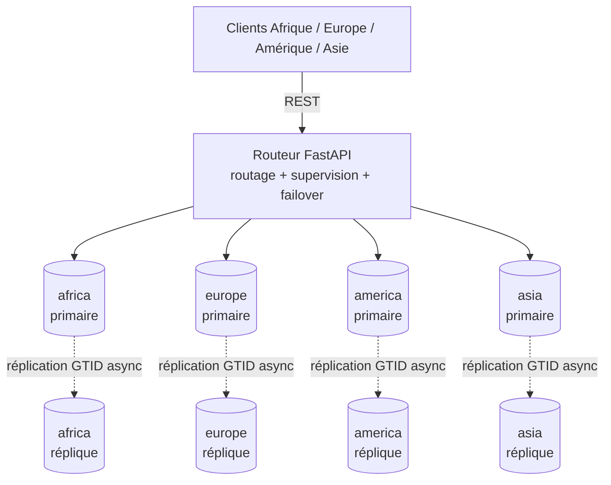

# GlobalShop — Base de données distribuée résiliente

Prototype d'une base de données distribuée pour une plateforme e-commerce internationale :
**4 shards** (Afrique, Europe, Amérique, Asie), chacun avec **1 primaire + 1 réplique MySQL 8.4**,
un **routeur** FastAPI (routage, cohérence, supervision, failover automatique) et des
**tests automatisés** de charge et de chaos.

## Démarrage rapide

```bash
docker compose up -d --build        # 8 MySQL + routeur (≈ 3 Go de RAM pour Docker)
pip install -r scripts/requirements.txt
python scripts/demo.py              # démo + 100 achats concurrents + test de chaos
```

- Interface : http://localhost:8000 — API/Swagger : http://localhost:8000/docs
- État du cluster : `GET /cluster` · journal des événements : `GET /events`
- Repartir de zéro : `docker compose down -v && docker compose up -d --build`

Le premier démarrage prend 1 à 2 minutes (initialisation des 8 MySQL puis mise en place de la
réplication par le routeur). `demo.py` attend automatiquement que les 4 shards soient `OK`.

## Architecture



## Stratégie de partitionnement

| Entité | Clé de partition | Justification |
|---|---|---|
| Clients | région géographique | proximité des données du client, inscription routée directement |
| Produits | `crc32(nom normalisé) % 4` | répartition uniforme du catalogue et de la charge |
| Commandes, factures | shard du **produit** | colocalisées avec le stock : décrément + commande + facture = une seule transaction locale ACID |

**IDs globalement uniques** : chaque shard utilise `auto_increment_increment = 4` et
`auto_increment_offset = rang du shard (1..4)`. Le shard propriétaire se déduit de l'ID :
`shard = SHARDS[(id - 1) % 4]`. Les lectures par ID vont donc directement au bon nœud, sans balayage.

**Lectures distribuées** (catalogue, clients, commandes) : scatter-gather parallèle sur les 4 shards.
Si un shard est totalement indisponible, la réponse est marquée `"partial": true` avec la liste
`unavailable_shards` ; si seule la réplique répond, `served_by_replica` l'indique (lecture potentiellement en retard).

## Réplication et failover

- **Réplication MySQL asynchrone par GTID** (`SOURCE_AUTO_POSITION=1`), un primaire et une réplique par shard.
- Le **routeur supervise** les 8 nœuds toutes les secondes. Il configure lui-même la réplication au démarrage.
- **Failover automatique** : après `FAILOVER_THRESHOLD` (3) sondes consécutives en échec du primaire, le routeur
  promeut la réplique : il laisse le thread SQL appliquer tout le relay log, détache la réplique, la passe en écriture,
  puis bascule le routage. Détection + promotion : quelques secondes.
- **Fencing / retour de l'ancien primaire** : à son retour, il est immédiatement verrouillé en lecture seule
  (`super_read_only`) puis rattaché comme réplique du nouveau primaire. Un seul écrivain à tout instant : pas de split-brain.
- **`NEEDS_RESYNC`** : si l'ancien primaire détient des transactions validées mais jamais répliquées
  (conséquence du mode asynchrone), MySQL refuse son rattachement. Le shard reste utilisable (nouveau primaire)
  mais sans redondance, jusqu'à resynchronisation (voir plus bas).

## Théorème CAP et PACELC

- **CAP : CP.** Pendant une panne, un shard dont le primaire est injoignable **refuse les écritures (HTTP 503)**
  plutôt que d'accepter des écritures divergentes. Les autres shards continuent de fonctionner (isolation des pannes).
- **PACELC : PC/EC.** En cas de partition (P) on choisit la cohérence (C). Sans partition (E), on choisit encore la
  cohérence plutôt que la latence : le stock est toujours lu et écrit sur le primaire avec verrou de ligne.
  Une lecture sur réplique n'est tolérée que si le primaire est HS, et elle est alors signalée (`served_by_replica`).

## Anti-survente (écritures concurrentes)

Un produit n'a **qu'un seul écrivain** : le primaire de son shard (pas de multi-maître, donc pas de conflit à résoudre).
Dans `POST /orders`, une transaction unique fait :
1. `SELECT ... FOR UPDATE` sur la ligne du produit (sérialise les acheteurs concurrents) ;
2. `UPDATE ... SET stock = stock - q WHERE stock >= q` (2e barrière) ;
3. insertion de la commande et de la facture, puis `COMMIT`.

En dernier recours, `CHECK (stock >= 0)` en base empêche tout stock négatif. Stock et commande étant colocalisés,
**aucune transaction distribuée (2PC) n'est nécessaire**.

## API

| Méthode | Route | Description |
|---|---|---|
| POST | `/clients` | inscription (shard = région ; email unique sur tout le cluster) |
| GET | `/clients` | liste distribuée |
| POST | `/products` | création (shard = hash du nom) |
| GET | `/products`, `/products/{id}` | catalogue distribué / lecture par ID |
| GET | `/products/{id}/audit` | stock, commandes, unités vendues, IDs (contrôle d'intégrité) |
| POST | `/orders` | commande transactionnelle (409 stock insuffisant, 503 shard indisponible) |
| GET | `/orders`, `/orders/{id}` | liste distribuée / détail avec facture |
| GET | `/health`, `/cluster`, `/events` | supervision, rôles primaire/réplique, journal |
| GET | `/route?name=` | shard où serait placé un produit de ce nom |

## Tests automatisés

```bash
python scripts/demo.py                    # tout
python scripts/demo.py --only functional  # Partie 2 : inscription, produits, catalogue, commande
python scripts/demo.py --only load        # Partie 3.1 : 100 achats simultanés, stock 20
python scripts/demo.py --only chaos       # Partie 3.2 : kill brutal d'un primaire pendant des écritures
python scripts/demo.py --only chaos --shard asia --workers 30
```

Les résultats sont écrits dans `results/demo_results.json` (chiffres à citer dans le rapport).

**Test de charge** : 100 clients lancent un achat au même instant (barrière de synchronisation) sur un produit au stock
de 20. Attendu : exactement 20 commandes acceptées, 80 refus HTTP 409, stock final 0, aucune erreur.

**Test de chaos** : 20 écrivains en continu → `docker kill` du primaire du shard cible (SIGKILL) → observation :
codes HTTP (503 = refus CP), fenêtre d'indisponibilité en écriture, instant du failover, reprise sans intervention,
**commandes acquittées perdues** (écart entre commandes acquittées et présentes après failover), commandes validées
mais non acquittées, invariant `stock + unités vendues = stock initial`, puis redémarrage de l'ancien primaire et
rattachement comme réplique (ou `NEEDS_RESYNC`).

> Avec une réplication **asynchrone**, une perte de quelques commandes acquittées juste avant le crash est possible
> (RPO > 0). Le test la mesure honnêtement ; c'est un point à discuter dans le rapport (compromis latence/durabilité).

## Resynchroniser un nœud (`NEEDS_RESYNC`)

Exemple pour l'ancien primaire d'Europe, devenu réplique en erreur :

```bash
docker compose stop mysql-europe-primary
docker compose rm -f mysql-europe-primary
docker volume rm globalshop_mysql_europe_primary_data
docker compose up -d mysql-europe-primary
```

Le nœud se réinitialise (même schéma) puis est automatiquement rattaché par le routeur ; il rejoue tout l'historique
depuis le binlog du nouveau primaire. Adapter les noms selon le shard et le rôle concerné.

## Structure

```
docker-compose.yml        cluster : 8 MySQL (4 primaires + 4 répliques) + routeur
init/01-schema.sql        schéma d'un shard (même fichier sur chaque nœud)
router/main.py            routage, transactions, supervision, failover
router/static/index.html  tableau de bord
scripts/demo.py           démo + test de charge + test de chaos
scripts/demo.sh           démarre le cluster puis lance la démo
results/                  résultats des tests (JSON)
```

## Limites et pistes d'amélioration

- Réplication asynchrone : RPO > 0 possible. Piste : réplication **semi-synchrone** MySQL
  (plugins `semisync_source` / `semisync_replica`) pour garantir qu'une commande acquittée existe sur la réplique.
- Une seule réplique par shard et un routeur unique (point de défaillance : à dupliquer derrière un load balancer).
- Une commande = un produit. Un panier multi-produits sur plusieurs shards demanderait une saga ou un 2PC (XA).
- Unicité de l'email vérifiée au mieux (shards injoignables ignorés pendant la vérification).
- Identifiants en clair dans `docker-compose.yml` et `init/01-schema.sql` : acceptable pour un prototype local.

## Dépannage

- **Windows** : `.gitattributes` force les fins de ligne LF pour les scripts. Si `demo.sh` échoue, lancer `python scripts/demo.py`.
- **RAM** : 8 instances MySQL (≈ 250 Mo chacune). Allouer au moins 3 Go à Docker.
- Cluster bloqué hors `OK` : consulter `GET /cluster` et `GET /events`, ou repartir de zéro (`down -v`).
